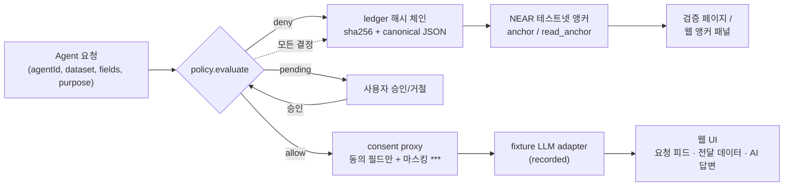

# Consent Guard

> **English summary.** Consent Guard is a consent gateway for AI agents (Nesa.ai x 블록체인밸리 hackathon, "Building AI through Privacy"). An agent only receives the fields the user consented to, for the consented purpose and time window; sensitive fields are masked, forbidden raw fields are always blocked, and revocation takes effect immediately. Every decision is written to a sha256 hash-chained audit log whose head is anchored on NEAR testnet. AI answers are recorded fixtures; no live LLM is called.

AI 에이전트가 개인 데이터에 접근할 때 **동의된 필드만, 동의된 용도·기간에만** 넘기는 동의 게이트웨이.

## 실행 방법

Node **23.6 이상** (루트 `.nvmrc`, `engines`; TypeScript를 type stripping으로 직접 실행, 빌드 단계 없음). Node 24.22에서 확인.

```bash
npm ci               # 또는 npm install. typecheck는 웹 워크스페이스의 @playwright/test 타입이 필요하므로 설치를 먼저 한다.
npm test             # 전체 워크스페이스 테스트 (119개: policy 26, proxy 10, ledger 35, integration 6, web 42)
npm run typecheck    # 전체 워크스페이스 tsc (5개 워크스페이스)
npm run demo:cli     # 데모 장면 1~5를 터미널에 출력, 마지막에 "ledger: 9 events, head faf3ef62b36a…" · "chain verified: OK"
npm run e2e          # Playwright 브라우저 e2e: 데모 5장면 + /?mock=1 오프라인 목 1개, 총 6개 (1280×800)
```

`npm run e2e`는 오프라인으로 실행됩니다. Playwright가 `127.0.0.1:4174`에 Vite 개발 서버를 직접 띄웠다 내립니다(`E2E_PORT`로 변경). `--strictPort`와 `reuseExistingServer: false`라서 해당 포트가 이미 쓰이면 잘못된 페이지를 치지 않고 바로 실패합니다. `verify:serve`는 `127.0.0.1:4173`을 쓰므로 e2e와 동시에 돌려도 됩니다. 테스트넷 `read_anchor` RPC 호출은 `page.route`로 가로채 데모 최종 장부 헤드(11건)를 돌려줍니다. 브라우저는 다운로드하지 않고 시스템 Chrome(`/usr/bin/google-chrome`, `CHROME_PATH`로 변경)을 씁니다.

발표 당일 점검과 오프라인 대체(목 RPC, 백업 영상, 장면 PNG)는 [`docs/RUNBOOK.md`](docs/RUNBOOK.md)를 본다. 발표장 인터넷이 없으면 웹을 `/?mock=1`로 열거나 `VITE_ANCHOR_MOCK=1 npm run dev`로 띄운다. 패널에 `목 RPC · 오프라인 대체`가 보이며, 테스트넷 RPC를 호출하지 않는다.

웹 데모 (Vite 개발 서버, http://localhost:5173/):

```bash
npm run dev            # 또는 npm run dev -w @consent-guard/web
```

백업 데모 영상: [`demo/video/consent-guard-demo.webm`](demo/video/consent-guard-demo.webm) (1280×800, 약 65초, 5장면). 다시 녹화하려면 (시스템 `ffmpeg` 필요, 자체 Vite 서버를 `127.0.0.1:4174`에 띄웠다 그 PID만 종료):

```bash
DEMO_REAL_RPC=1 npm run demo:video -w @consent-guard/web
```

`DEMO_REAL_RPC=1`이면 `read_anchor`를 실제 NEAR 테스트넷 RPC에 읽기 전용으로 호출하며(키 불필요), 로드 직후 `앵커 전`, 5장면 뒤 `일치 ✓`가 아니면 영상을 덮어쓰지 않고 실패합니다. 빼면 e2e와 같은 모킹으로 오프라인 녹화합니다. 녹화 후 장면별 증거 프레임(PNG)을 `EVIDENCE_DIR`(기본: 저장소 안 `evidence/demo-video/`)에 추출합니다.

정적 검증 페이지 (빌드 없음, http://127.0.0.1:4173/verify/):

```bash
cd packages/ledger && npm run verify:serve
```

이벤트 JSON을 붙여넣거나 **Load sample fixture**를 누른 뒤, 테스트넷 계약의 `read_anchor` 또는 붙여넣은 헤드 해시와 비교합니다. 결과는 GREEN(`verified`) / RED(사유와 위치 표시).

## 데모 장면

시계는 `fixtures/demo.json`의 **2026-11-20 20:00 KST**에 고정되어 있고, 웹에서는 **"+10분"** 버튼으로만 움직입니다. 아래 사유 문자열은 정책 엔진이 실제로 출력하는 값입니다.

1. **카드 내역 자동 허용 + 가맹점명 가림** — `budget-agent`가 `card_tx`의 `category, amount, merchant` 요청 → 허용, `merchant`는 `***`로 전달.
   `grant-card-budget 권한으로 허용(가림: merchant)`
2. **계좌번호 원문 요청 차단** — `tax-agent`가 `account_number` 요청 → 동의와 무관하게 거부, AI 호출 안 함.
   `원문 금지 필드 요청: account_number`
3. **진료기록 승인 대기 → 사용자 승인** — `health-agent`의 `medical_record` 전체 요청 → 승인 대기.
   `health-agent: 민감 데이터셋(medical_record)은 소유자 승인이 필요함`
   웹에서 승인하면 요청한 그대로의 1시간짜리 권한이 생기고 재평가되어 허용(`사용자 승인` 태그). CLI는 승인 대기까지만 보여줍니다.
4. **알레르기 식단 용도 10분 허용 → 만료 거부** — `diet-agent`가 `diet_recommendation` 용도로 `allergy`만 요청 → 허용(`grant-allergy-diet 권한으로 허용`). 웹에서 **"+10분"**(CLI는 +11분)을 누르면 후속 요청이 거부됩니다.
   `diet-agent/medical_record: grant-allergy-diet 권한이 만료됨`
5. **카드 권한 철회 → 재요청 즉시 거부** — `grant-card-budget` 철회 직후 같은 에이전트의 재요청이 거부되고 AI는 호출되지 않습니다.
   `budget-agent/card_tx: grant-card-budget 권한이 철회됨`
   이어서 감사 로그에 **해시 체인 검증 ✓**, 그 아래 **온체인 앵커 상태** 패널(블록 높이, 앵커 tx·계약 링크)이 표시됩니다. 패널은 테스트넷 `read_anchor`를 한 번 읽고, 렌더링마다 **현재 진행 중인 데모 장부**(건수·헤드 해시)와 비교합니다. 시계가 고정이라 5장면을 끝까지 진행한 장부는 항상 같은 헤드가 되며, 그 최종 헤드(11건)가 앵커되어 있습니다.
   - 11건 미만: `11건 중 N건 · 앵커 전`
   - 11건이고 헤드 일치: `현재 장부 = 온체인 앵커 일치 ✓`
   - 헤드 불일치, 11건 초과, 장부 해시 체인 손상, 온체인 앵커 없음: `온체인 앵커 불일치 ✗`
   - RPC 실패·시간 초과(5초): `앵커 확인 불가`

## 아키텍처



| 패키지 | 역할 |
| --- | --- |
| `packages/policy` | 순수 정책 엔진 `evaluate` (allow / deny / pending, 한국어 사유), `applyMask`. 공용 타입 `src/types.ts` |
| `packages/proxy` | 동의 프록시: 정책 통과분만 마스킹해 어댑터로 전달, fixture LLM 어댑터 |
| `packages/ledger` | sha256 해시 체인, 변조 검출, NEAR 앵커 계약(Rust)·스크립트(기본 dry-run), 정적 검증 페이지 |
| `packages/integration` | 프록시 + 장부 파이프라인, 장면 1~5, `demo:cli` |
| `apps/web` | React + Vite 데모 UI (고정 시계, "+10분", 승인/철회, 감사 로그, 앵커 패널) |
| `fixtures/` | `demo.json`(시계·권한·요청), `sample-data.json`(합성 데이터), `ai-responses.json`(녹화된 AI 답변) |

## 프라이버시 보장

- **원문 금지 필드 차단** — `account_number`, `card_number`, `resident_id`, `ssn`, `cvv`, `password`는 어떤 동의가 있어도 거부.
- **마스킹** — 동의의 `maskFields`는 값이 `***`로 바뀌어 전달되고, 동의 범위 밖 필드는 아예 전달되지 않음(요청에 포함되면 거부).
- **철회 즉시 차단** — `revokedAt` 이후 요청은 거부되며 재요청 시 AI 호출 0회(통합 테스트에서 어댑터 호출 횟수로 확인).
- **해시 체인** — 각 이벤트(grant / access / deny / pending / revoke)를 canonical JSON의 sha256으로 연결. 변조 시 실패 위치(index)와 사유까지 검출, 꼬리 절단은 앵커 비교로 검출.
- **온체인 앵커** — NEAR 테스트넷 계정 `consent-guard-anchor.tee-receipts-chamdom.testnet`에 장부 헤드 해시와 개수를 기록. 현재 앵커(웹 데모 최종 장부): 11건, 헤드 `259dbd26…fa95b`, 블록 278,539,285, tx [51udtFvQ4Po2E4Pj6H2gTTKAvK2VRKCGgBeAN7A25P2y](https://testnet.nearblocks.io/txns/51udtFvQ4Po2E4Pj6H2gTTKAvK2VRKCGgBeAN7A25P2y). 첫 앵커(샘플 fixture 5건, tx `Gx1HfEQY…`)는 이력이며 자세한 내용은 `packages/ledger/README.md`.
- **재요청(replay) 차단** — 이미 처리된 request id로 다시 요청하면 거부: `이미 처리된 요청 id(재요청 차단): <id>`.
- **용도·기간·행 수 제한** — 동의에 없는 용도, `maxRangeDays` 초과 기간, `maxRows` 초과 행 수는 거부.
- **TTL** — 모든 동의에 `expiresAt`이 있으며 지나면 거부(웹에서 승인으로 생긴 권한은 1시간).

## AI 응답에 대하여

- AI 응답은 **녹화된 fixture**(`fixtures/ai-responses.json`)이며 실제 LLM을 호출하지 않습니다. API 키도 없습니다.
- 화면의 AI 답변 카드에는 **`recorded`** 배지가, CLI에는 `AI [recorded]`가 표시됩니다.
- 해당 request id의 fixture가 없으면 어댑터가 에러를 던지고(웹: `AI 응답 없음 (라이브 모델 호출 안 함)`), 실모델로 넘어가지 않습니다.
- 정책이 허용한 요청만, 마스킹된 행만 어댑터에 전달됩니다.

## 한계 / 주의

- **테스트넷 전용**: NEAR 테스트넷만 사용합니다. 앵커 스크립트는 기본 dry-run이며, 실제 전송은 `--execute`와 `CONSENT_GUARD_ALLOW_TESTNET_WRITE=1`이 모두 있어야 합니다.
- **녹화된 AI**: 답변 품질·내용은 실제 모델 동작을 보여주지 않습니다.
- **합성 데이터**: 카드 내역, 진료기록 등 데모 데이터는 모두 가상입니다.
- 앵커는 웹 데모 5장면의 최종 장부 하나뿐입니다. `demo:cli` 장부(9건, 승인 없이 +11분)는 시나리오가 달라 앵커와 비교되지 않으며, fixture나 상태 전이가 바뀌면 최종 헤드가 달라지므로 재앵커가 필요합니다(`apps/web/test/demoScenario.test.ts`가 실패로 알려줌).
